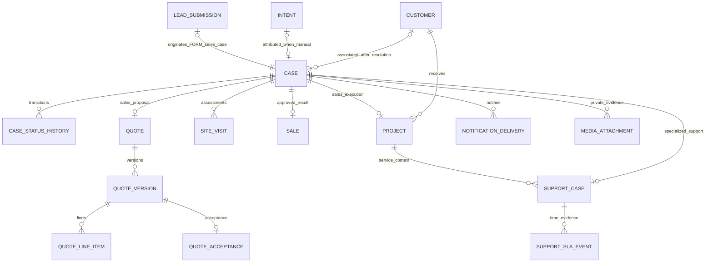

# ADR-001 — Canonical SOLIMA Case, Commercial and Support Domain

- Date: 2026-11-19
- Status: **PROPOSED — REVIEW REQUIRED; NOT AN OFFICIAL APPROVAL**
- Scope: SOLIMA Core, SOLIMA Office, PostgreSQL modeling
- Working branch: `reconcile/b0r-unified-baseline`
- Source code at analysis: `7c5198149e509cd2bcc837fbc0b51a3a361871e6`
- Precondition: B0-R reconciled source and full GitHub Actions push/PR suites PASS at that SHA.
- Safety: no Prisma migration, production change, automatic branch merge, or service activation is authorized by this ADR.

## 1. Conflict and precedence

The later `SOLIMA-PROMPT-MESTRE-IMPLEMENTACAO` defines `LeadSubmission` as immutable intake and `Case` as the central operational object, with separate `Sale`, optional `Intent`, and type-specific workflows. The implementation B1–B3 already persists those entities.

`BACKEND-CONCEPTUAL-DOMAIN-MODEL.md` and `BACKEND-POSTGRES-LOGICAL-MODEL.md` describe a separate mutable commercial `Lead`, `LeadStatusHistory`, `Quote`, `Project`, and `SupportCase`. The latter logical model is explicitly a DRAFT. Implementing both mutable `Lead.status` and `Case.workflowState` would duplicate the sales opportunity and permit contradictory statuses.

**Proposed precedence:** latest explicit domain decisions (including the implementation prompt) > documented approved domain invariants > currently tested code > older modeling assumptions. When precedence alone does not resolve a material semantic change, record it as a proposed decision rather than silently assuming approval.

## 2. Options evaluated

| Option | Benefit | Problem | Recommendation |
| --- | --- | --- | --- |
| A. Mutable `Lead` and `Case` both control sales | Keeps prior PostgreSQL DER literal | Duplicate state machines, synchronization, migration complexity | Reject |
| B. `Case` owns operational/commercial workflow; quote, sale, project and support are purpose-specific | Preserves B1–B3, works with manual/WhatsApp/FORM channels and one Office inbox | Requires revising the old DER, numbering and some history naming | **Preferred** |
| C. Replace `Case` with `Lead` for sales, retain `Case` only for support | Simple specialized sales tables | Reverses later requirement, rewrites B1–B3, fragments Office | Reject |

## 3. Proposed canonical aggregate boundaries

| Aggregate or model | Responsibility and owner | Identity, relationship and restrictions |
| --- | --- | --- |
| `LeadSubmission` | Original public FORM intake and contact/service/media snapshot | Exactly one originating `Case(type=SALES)` on successful new FORM; idempotency key unique. Original business snapshot never edited to reflect Office changes. `deliveryStatus` is transport/legacy state, not sales status |
| `Intent` | Independent CTA attribution | WhatsApp click creates Intent but does not prove a conversation; current single optional linked Case is preserved. No Customer created on click |
| `Case` | Universal operational work item, `type`, `channel`, assignee, priority, timeline and *one* authoritative `workflowState` | Types initially SALES, SUPPORT, WARRANTY, COMPLAINT, GENERAL; type and channel are independent; domain-service transition guards are type-specific |
| `CaseStatusHistory` | Append-only history of Case transitions for sales and support | One transition per committed change with actor, time, old/new states, reason and business correlation; no duplicate editable `LeadStatusHistory` or `SupportStatusHistory` state source |
| `Quote`, `QuoteVersion`, `QuoteLineItem`, `QuoteAcceptance` | Versioned commercial proposal for `Case(type=SALES)` | At most one Quote per sales Case, many versions; issued versions immutable; one accepted version; MZN exact decimal, tax policy approved separately |
| `SiteVisit` and `SiteVisitReport` | Assessment before a sales Case can be approved | Belong to sales Case; construction and modernization require eligible completed visit before Quote issue; maintenance may use recorded permitted remote assessment |
| `Customer` | Reusable master identity for multiple Cases, sales and projects | Public FORM or CTA does not create Customer. Resolve/create on authorized sales approval, using normalized phone and a unique active-phone constraint; never silently transfer number |
| `Sale` | Explicit approved commercial result, distinct from progress or delivery status | Proposed one source Sale per approved sales Case and accepted QuoteVersion; value is **contracted amount, not money received**; future invoicing/payments are separate |
| `Project` | Execution of accepted sales work | Proposed one Project per approved sales Case, with independent lifecycle/history and Customer relation; project cannot be inferred from a FORM or WhatsApp Intent |
| `SupportCase` *specialization* | Support-specific properties: Project, category, SLA, source, resolution metadata | Proposed exactly one specialty record per Case of type SUPPORT/WARRANTY/COMPLAINT; mandatory existing Project; workflow status stays in `Case.workflowState`, SLA events do not duplicate the status source |
| `NotificationDelivery` | Post-commit asynchronous provider work | Provider statuses never update operational/commercial Case state; B3 SMTP path and legacy Meta paths remain distinct |
| `MediaAsset`/`MediaAttachment` | Durable private, authorized business evidence | Distinct from temporary public transport `LeadMedia`; owner/purpose/retention explicit; no public direct object keys |
| `AuditEvent` | Security and material business-command accountability | Append-only, no secrets or raw uploads; separate from end-user Case timeline |

### Terminology migration

- Historic conceptual `Lead` (mutable sales opportunity) becomes **the `Case(type=SALES)` commercial projection**. Do **not** add a second independently writable `lead.status`.
- Historic `LeadStatusHistory` transitions become `CaseStatusHistory` for SALES Cases.
- Historic conceptual `lead_id` relationships on Quote/SiteVisit/Project become `sales_case_id` (or explicit `case_id` plus SALES-type enforcement).
- `LeadSubmission` **retains its name, immutable snapshot, idempotency and original identifiers**. It is not renamed to `Case` or commercial `Lead`.
- Historic conceptual `SupportCase.status` and `SupportCaseStatusHistory` must not compete with `Case.workflowState`; specialize category and SLA, with Case transitions as authoritative.
- The current `Case.publicReference` and old external identifiers must be preserved. New annual numbering (SOL-L/SOL-Q/SOL-P/SOL-S) requires a separate forward-only numbering policy: no retroactive renumbering without an explicit migration contract.

## 4. Proposed relationships

Mermaid is conceptual; do not translate it literally into Prisma until cardinalities, legacy mapping and PostgreSQL FK/unique constraints are reviewed. `Case.sourceLeadSubmissionId` and `Case.sourceIntentId` preserve existing uniqueness.

## 5. State ownership

- SALES Case: `NEW → CONTACTED → QUALIFIED → APPROVED` or authorized terminal `LOST`, `CANCELLED`, `DUPLICATE`, preserving approved reasons and audit. Quoting and site visit are *related objects*, not redundant SALES states.
- QUOTE VERSION: `DRAFT → ISSUED → ACCEPTED / SUPERSEDED / DECLINED / EXPIRED`; DRAFT can be VOIDED. Version state independent from Case.
- PROJECT: `PLANNED → IN_PROGRESS ↔ PAUSED → COMPLETED → ARCHIVED`, and permitted cancellation/archival paths.
- SUPPORT-type Case: `OPEN → TRIAGED → IN_PROGRESS ↔ WAITING_CUSTOMER → RESOLVED → CLOSED`, with explicit reopen/cancel commands. `SupportCase` specialty keeps SLA cycles/policy references but does not separately store an authoritative business status.
- DELIVERY: `PENDING/PROCESSING/RETRY/SENT/FAILED` for email; preserve legacy Meta statuses separately.
- SALE: proposed confirmed contract record, not receipt of money. Any later cancellation, adjustment or return must preserve financial history rather than hard-delete the record.

The proposed mapping keeps the separate Project and Quote lifecycles from the conceptual docs, while removing only **duplicate** sales/support workflow state.

## 6. Transaction boundaries and concurrency

**T1 — Public FORM intake (existing B3):** check UUID idempotency and fingerprint; validate inputs and processed media; atomically insert LeadSubmission, one SALES Case and one deduplicated EMAIL NotificationDelivery; commit before SMTP. Concurrent retries return existing graph, not extra Cases/emails. Provider failure cannot remove the Lead/Case.

**T2 — WhatsApp attribution (existing B1/B2):** create Intent before `wa.me`. When authenticated staff later confirms a real conversation, it may create/associate one Case. A click never generates a Sale or Customer.

**T3 — Quote issue/accept:** only an authorized administrator issues an immutable version after service-specific site-visit/remote-assessment prerequisites; acceptance requires explicit verifiable evidence. Conditional transitions must serialize acceptance vs expiry. No Sale/Project is created just by acceptance.

**T4 — Sales approval (PROPOSED extension):** authenticate and authorize; lock SALES Case and accepted QuoteVersion; verify eligible current state and uniqueness; resolve/create Customer by normalized phone; atomically mark Case APPROVED, create or return a single Sale and Project, append Case/Project status history and AuditEvent; commit. Retries must return the existing result without duplicate Sale/Project. **Sale creation in the same transaction is a proposed change and awaits explicit product approval.** Avoid committing external email/provider calls here.

**T5 — Support registration (PROPOSED extension):** authenticate; verify existing Project; create Case(type SUPPORT/WARRANTY/COMPLAINT) + one SupportCase specialty + initial Case history + SLA cycle + AuditEvent; commit. Initial public support endpoint remains disabled. Cases without a real SOLIMA Project cannot bypass the Project requirement; GENERAL inquiries must not be falsely classified as Support.

**T6 — Transitions and private media:** type-specific, authenticated, object-authorized commands with expected-version/concurrency guards, append-only history and AuditEvent. Media reads require authorization and access audit. No generic unrestricted PATCH.

## 7. PostgreSQL cutover: mapping, not rewrite

Existing SQLite Prisma models: `Intent`, `LeadSubmission`, `Case`, `NotificationDelivery`, `LeadSubmissionExtra`, `LeadMedia`, `WhatsAppDelivery`. `Case` has `sourceLeadSubmissionId @unique`, `sourceIntentId @unique` and current `workflowState`. Do not drop/rename their identifiers during initial expansion.

Target PostgreSQL design gate:

1. First inventory real production/staging SQLite data, schema migration versions, backup method, delivery/outbox backlog and active media; deployment state is NOT established by code alone.
2. Define a PostgreSQL schema that keeps all B3 IDs, dedupe keys, fingerprints and old outbox statuses; introduce new business tables additively.
3. Design explicit legacy reconciliation for Leads without a Case (possible in production older than B2); deterministic backfill with one Case per original LeadSubmission, safe repeatability and a dry-run report.
4. Preserve pending/processing notification semantics and reconcile messages that may have been externally delivered before a restore. Never assume exactly-once SMTP/Meta.
5. Run migration on scrubbed/isolated copy, FK/unique/count/checksum checks, concurrent approval/phone uniqueness tests, media authorization tests, rollback rehearsal and restore drill.
6. Only then consider production cutover, with backup and explicit release approval.

**No new PostgreSQL migrations or production database operations are performed by this ADR.**

## 8. Outstanding explicit decisions

1. **Domain ADR acceptance:** approve Case as the single SALES/Support workflow owner, rather than an independent mutable `Lead` table.
2. **Sale timing:** create Sale atomically on Case approval (preferred), or separate explicit financial confirmation. In neither model does Sale equal cash payment.
3. **Photo contract:** latest implementation instruction sets maximum 3 LOCATION + 2 INSPIRATION / 5 total; later conceptual design demands minimum 1 LOCATION. Candidate effective rule is 1–3 LOCATION and 0–2 INSPIRATION, <=5 total, activated only after compatibility tests/versioned rollout.
4. **Numbering:** preserve existing Case references and specify forward-only public numbers for Case/Quote/Project/Support.
5. **Office trust boundary:** `SUPER_ADMIN` owner initially vs future permission-based STAFF/VIEWER; authentication method, CSRF, session policy, gateway/host restriction and recovery path need approval.
6. **Commercial fiscal policy:** MZN exact decimals and issued-version immutability are documented; tax default still requires accountant confirmation.
7. **Support operations:** use the existing SLA draft policy (Africa/Maputo, hours/targets), but approve alert thresholds and admin override permissions before enabling automated deadlines.
8. **Retention:** no destructive automation until legal/accounting/security durations and backup policy are externally validated.
9. **Historic data cutover:** determine whether any actual deployed SQLite data requires migration, and how pending legacy provider deliveries are reconciled.

## 9. ADR-001 acceptance tests (design to implementation)

- FORM idempotent replay produces exactly one original LeadSubmission and one SALES Case.
- Manual WhatsApp Case can link an existing Intent without treating click as conversation; race creates at most one Case.
- A Sales Case transitions through exactly one authoritative state machine; no independent `lead.status`.
- Accepted QuoteVersion is immutable; accepting it alone creates neither Customer nor Project.
- Concurrent approvals create at most one active Customer per phone and one Sale/Project per sales Case.
- No approval without accepted QuoteVersion, proper prerequisites, identity and authorization.
- A SupportCase cannot exist without real Project and matching parent support Case.
- All Case transitions and material commands create append-only history/audit; no hard-delete.
- Email delivery failure leaves LeadSubmission/Case intact and supports retry.
- Private image access denies unauthorized users and does not expose underlying storage keys.
- Existing responsive/visual/browser QA stays green.
- Legacy SQLite-to-PostgreSQL data mapping preserves IDs, history, outbox states and business counts.

## 10. Next gate

Status remains **PROPOSED**. Review/accept explicit decisions, amend old conceptual/logical models by references (do not erase their historical content), then begin PostgreSQL inventory/cutover design. Until then do not generate final SQL/Prisma models or start destructive data migrations.
